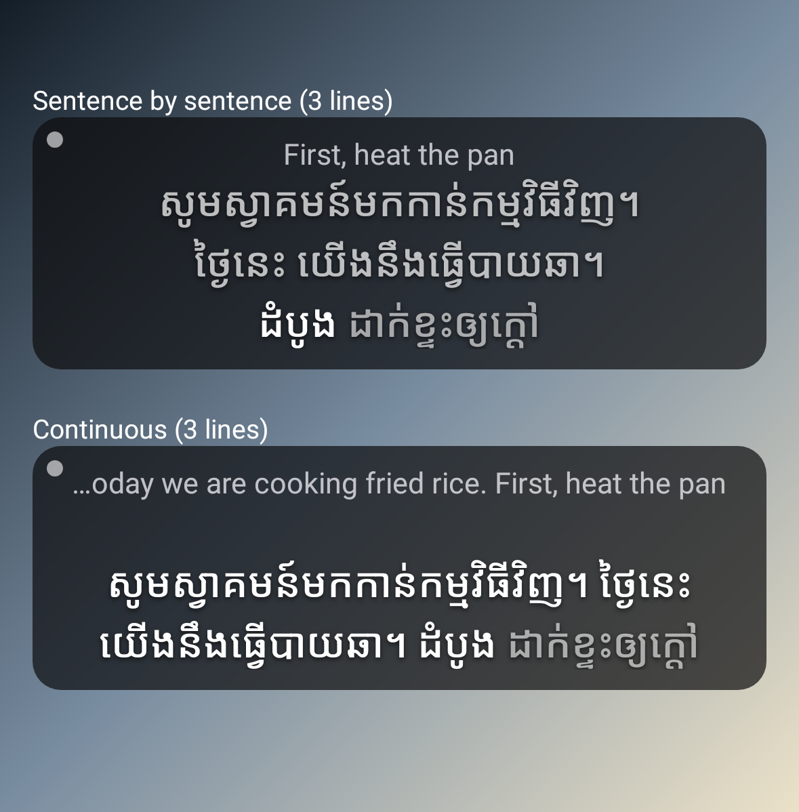
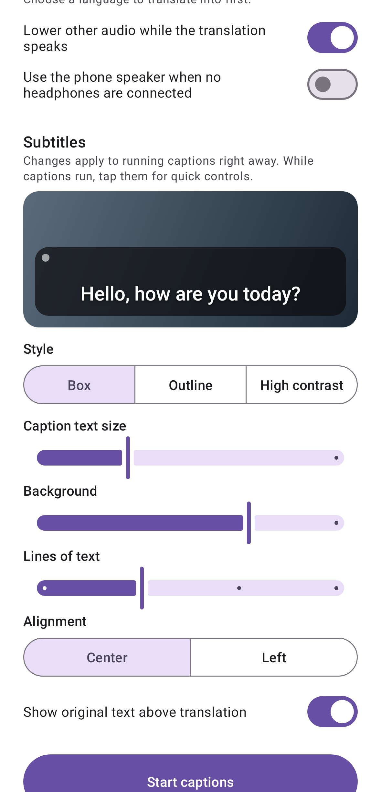
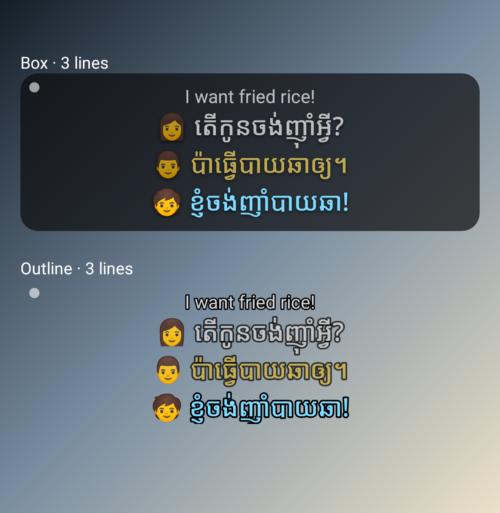
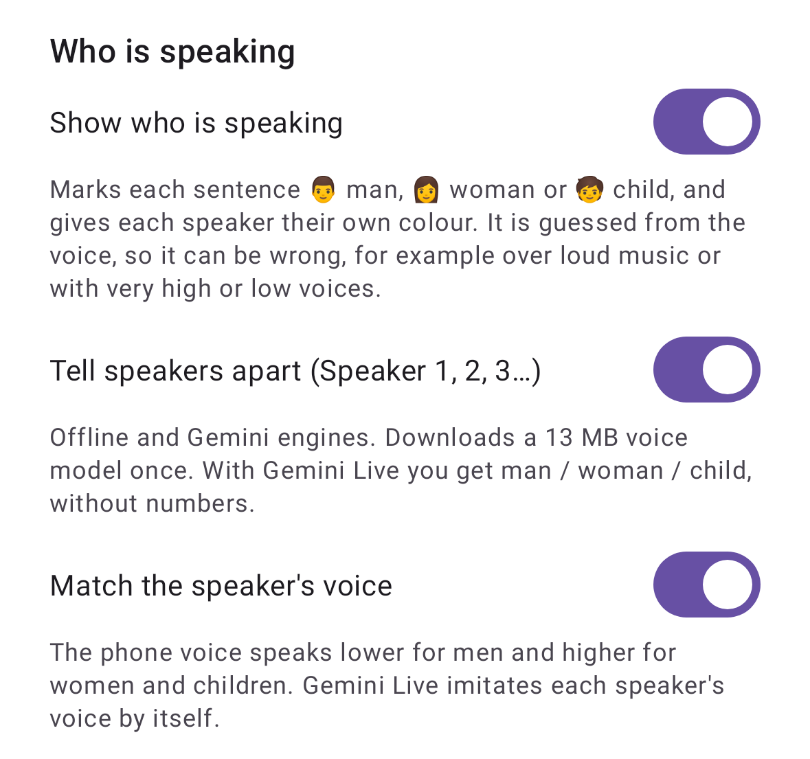
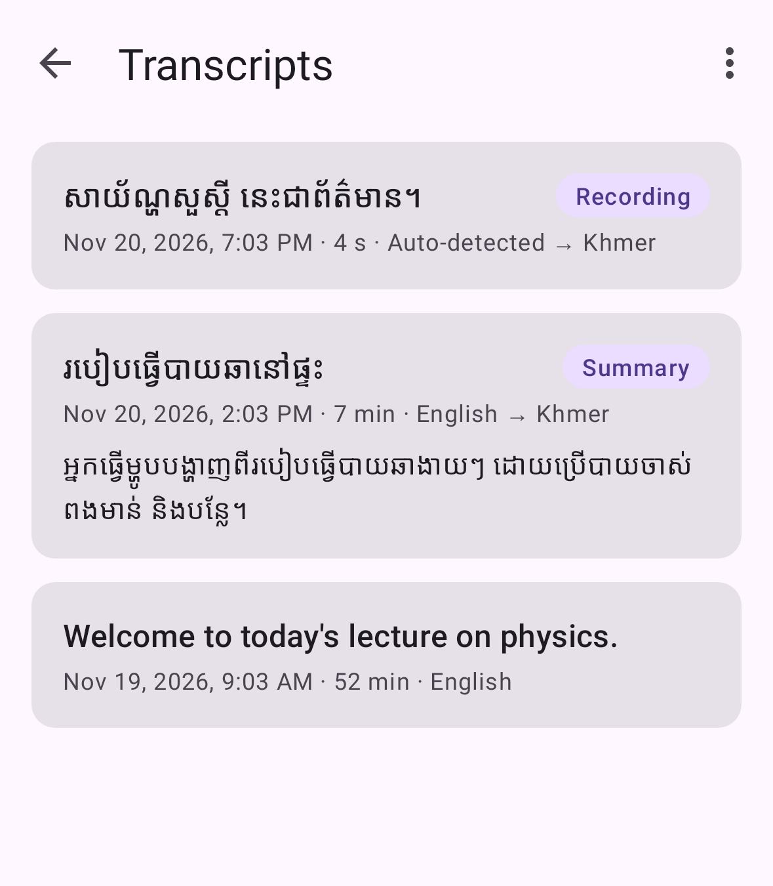
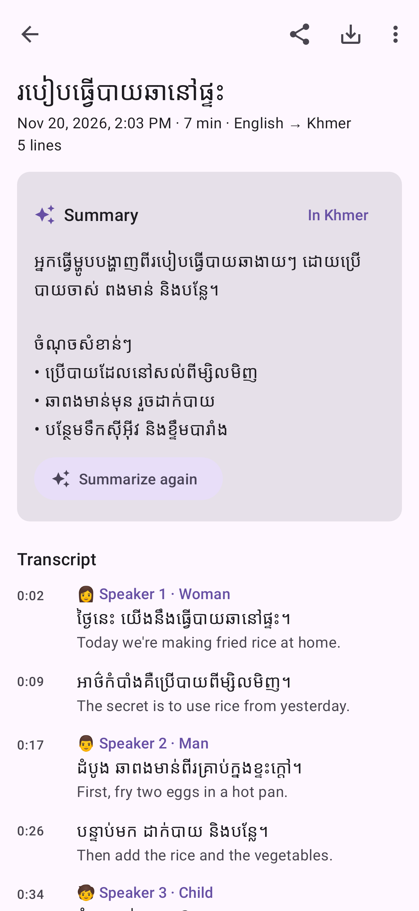

# Live Caption

An Android app that shows real-time subtitles in a floating box on top of any app, translates
them, and can speak the translation into your headphones.

## Translation engines

Pick one under **Translation engine**:

| | Offline | Gemini | Gemini Live |
| --- | --- | --- | --- |
| How | Vosk speech-to-text → ML Kit (or NLLB for Khmer) | Vosk speech-to-text → Gemini text translation | Audio → Gemini 3.5 Live Translate → translated speech + captions |
| Spoken languages | 25 (chosen up front) | 25 (chosen up front) | 70+, detected automatically (Khmer included) |
| Target languages | ~59 + Khmer | ~59 + Khmer + Live languages | 78 (Khmer included) |
| Voice in headphones | Phone's text-to-speech voice | Phone's text-to-speech voice | Gemini's natural voice, close to real time |
| Needs | One-time model downloads | Internet + Gemini API key | Internet + Gemini API key |
| What leaves the phone | Nothing | Caption text | The audio |

```
Offline / Gemini:  audio ─▶ Vosk ─▶ TranslationPipeline ─▶ ML Kit / NLLB / Gemini ─▶ overlay
                                                                              └──▶ text-to-speech ─▶ headphones
Gemini Live:       audio ─▶ LiveTranslator (WebSocket) ─▶ translated speech ─▶ headphones
                                                       └─▶ both transcripts ─▶ overlay
```

**Gemini API key**: create one for free at <https://aistudio.google.com/apikey> and paste it
into the key field. Both Gemini engines work on the free tier; Google limits free keys per
minute and per day. Live Translate on a paid key costs about $0.037 per minute of audio
(Google's pricing page, November 2026).

## Subtitles


Tap the floating subtitles for a toolbar; it hides again after a few seconds:


| Button | Does |
| --- | --- |
| ⏸ / ▶ | Pause or resume (pausing finishes the sentence in progress first) |
| 🔊 | Voice on / off (a headphone icon means it is waiting for headphones) |
| A− / A+ | Smaller / bigger text |
| Aa | Next style: Box, Outline (film-style, no box), High contrast (yellow on black) |
| ▭ | Show or hide the original text above the translation |
| 📄 | Open the transcript of this session (read it, summarize what was said so far) |
| 🔒 | Lock: touches go through to the app underneath, e.g. a video's controls. Unlock from the notification or by opening Live Caption |
| ⚙ | Open Live Caption settings |
| ✕ | Stop captions |

- **Sentence by sentence** (on by default): each sentence starts on its own line. The newest one
  is always shown whole at the bottom, and earlier sentences stay above it, slightly dimmed,
  while they fit in the chosen number of lines. When a new sentence starts, the oldest one makes
  room instead of the text running together and being cut mid-sentence. Sentence ends are found
  in many scripts: `.` `?` `!` and Khmer `។`, Chinese and Japanese `。`, Hindi `।` and others.
  Numbers like "3.5" and abbreviations like "Mr." are not taken as ends. Turn it off in settings
  for one running line of text.

  

- **Moving:** drag the subtitles up or down; the position is remembered.
- **Readability:** a fixed number of lines (1–4) keeps the box from jumping, and the newest
  words stay visible at the bottom.
- **Dimmed words:** words that may still change (speech still being recognised) are drawn
  dimmer.
- **Status dot:** grey when listening, pulsing green when the translation is being spoken,
  amber when connecting, dark when paused.
- **Notification:** has Pause/Resume, Unlock (when locked) and Stop.

In settings, the **Subtitles** section has a live preview with style, text size, background,
lines and alignment. These settings, and the voice settings, apply to running captions
immediately.



## Who is speaking

| In the subtitles | Settings |
| --- | --- |
|  |  |

- **Voice type**: each sentence gets a 👨 man, 👩 woman or 🧒 child marker, guessed on the
  phone from the pitch of the voice (YIN pitch tracking on the captured audio). Once a speaker
  is recognised, their voice type comes from all their sentences, which is steadier than one.
- **Speaker numbers** (Offline and Gemini engines): different people are told apart as
  Speaker 1, 2, 3… using voiceprints (x-vectors) from Vosk's 13 MB speaker model, downloaded
  once. In the subtitles, each speaker after the first gets their own colour, as in TV
  subtitles. A voice that is only somewhat unfamiliar becomes a new speaker when it comes back,
  so one odd sentence (a laugh, a shout) doesn't add a person; until then it shows as the
  closest speaker. Sentences under about a second stay with the last speaker unless the pitch
  says otherwise. Gemini Live doesn't report who is speaking, so it gets voice types without
  numbers.
- **Matching voice**: the phone voice reading translations speaks lower for men and higher for
  women and children. Android doesn't say whether a voice is male or female, so the same voice
  is pitched up or down. Gemini Live imitates each speaker's voice by itself.
- **Transcripts**: speaker labels are saved ("Speaker 2 · Woman") and appear in the transcript
  screen, in .txt and .srt exports, and in the text sent for summaries.

How it was tuned, on real recordings:

| Check | Data | Result |
| --- | --- | --- |
| Man vs woman line | 222 gender-labelled Khmer recordings (Google FLEURS) | Men 112–143 Hz, women 211–236 Hz (5th–95th percentile); any line from 155 to 180 Hz was right for all; the app uses 170 Hz |
| Voice type in the app | 60 of those recordings, through the app's own pitch tracker | 57 right, 0 wrong, 3 too quiet to judge |
| Same line, other voices | 40 English readers (LibriSpeech dev-clean, 20 men and 20 women) | Speakers split 20/20 at 170 Hz. Single recordings fell on the other side of the line from their speaker 3–5% of the time, so voice type is judged per speaker, not per sentence |
| Child line | Same 40 readers | One adult woman's median was 263 Hz, so "child" starts at 290 Hz. No recordings of children were available to test |
| Comparing voiceprints | 27 of those readers, 1,457 sentences | Same person: median similarity 0.64; different people: 0.22. At the app's 0.55 threshold, 0.6% of different-people pairs look alike and 75% of same-person pairs match directly (comparing against a speaker's running average matches more) |
| Who said each sentence | Conversations of 2, 3 or 4 of those readers taking turns, 200 of each, replayed through the app's code (about 33 sentences per person, one recording session each, like one video) | 92.9% (2 people), 91.4% (3) and 90.1% (4) of sentences got the right speaker number. With each person's sentences mixed from recordings made on different days: 92.5%, 89.8%, 88.7% |

Tried and not used: taking an average voiceprint (from the Khmer recordings) away before
comparing voices didn't help on the English readers (balanced error 7.6% with and without it on
the 27 readers; 6.1% → 6.5% on the 40), because what voiceprints share depends on the recording.

Known limits: the main mistake is an extra number. In about half of the replayed 2-person
conversations (55%), someone also showed up under a third number at some point, when a couple
of their sentences sounded unlike the rest; overall 7% of sentences got a wrong number. Ending
up with fewer numbers than people was rare (under 2% of conversations). Pitch can't tell a high-voiced man from a woman, or an older child from a
woman (children with lower voices show as women). Loud music under speech confuses both. These
numbers come from clean read speech; real videos with music, noise or overlapping voices will
do worse.

## Transcripts and summaries

While captions run, every finished line (original, translation and time) is saved on the phone,
one file per session. Turn this off under **Transcripts and summaries** in settings.

| Saved sessions | A transcript with its summary |
| --- | --- |
|  |  |

- **Summary**: written by Gemini with your key: a title, a short overview, key points, and
  action items when there are decisions, tasks or questions. It is written in the translation
  language by default; you can pick the spoken language, the phone's language or English
  instead. While captions run, "Summarize so far" covers everything said up to that point.
- **Share / Copy** the transcript, with its summary, as text.
- **Save as file**: a text file (`.txt`), or a subtitle file (`.srt`) with the translation and
  original for each line, timed from when captions started.
- **Delete**: one transcript, or all of them (the one being recorded is kept).

Files are written as captions arrive, so a transcript survives the app being closed. Sessions in
which nothing was said are not kept. Transcripts are excluded from backups.

## Spoken translation in headphones

Turn on **Speak the translation in my headphones**. Then:

- **Headphones only by default**: wired, USB, Bluetooth or hearing aids. Without them the
  voice waits (headphone icon on the captions) unless "Use the phone speaker" is on.
- **Mute button**: the speaker button on the floating captions mutes or unmutes the voice at
  any time.
- **Ducking**: other apps' audio is lowered while the translation speaks. Some apps pause
  instead of lowering; turn off "Lower other audio" if that happens.
- **No feedback**: the app's own voice is excluded from audio capture, so it is never
  captioned again. In Microphone mode without headphones, the microphone is muted while the
  phone speaks.
- **Gemini Live voice**:
  - **Start buffer**: each phrase starts after a ~0.25 s buffer, so network hiccups don't make
    it stutter.
  - **Catching up**: when it falls behind the video it speeds up in steps (×1.1, ×1.25, ×1.4)
    and returns to normal speed gradually. Beyond 12 s behind, the oldest speech is skipped.
  - **Subtitles in sync**: translated subtitles appear when the voice says the words, not
    seconds earlier. This can be switched off.
  - **Louder voice**: optional, so it stands out over the original audio.
- **Phone voice**:
  - **No gaps**: the next sentence is queued while the current one plays.
  - **Voice choice**: an installed, high-quality voice is preferred over a network voice,
    which adds a delay before each sentence.
  - **Keeping up**: if sentences pile up, older ones are skipped and the voice talks a little
    faster.

For the Offline and Gemini engines, the settings screen checks that your phone has a
text-to-speech voice for the target language, offers to download it, and has a **Test voice**
button. Speech Services by Google includes Khmer.

## Translation quality

- **Context**: Gemini receives the last three captions and their translations, so names,
  pronouns and terms stay consistent. It is told the text comes from speech recognition, so it
  can fix misheard words.
- **Model**: Gemini uses `gemini-3.5-flash-lite` (low latency, tuned for translation) and falls
  back to `gemini-flash-latest` if a key can't use it.
- **No dropped sentences**: if sentences pile up, or Google's rate limit is hit, they are
  merged and translated together after the pause.
- **Topic hint**: an optional "What are you watching?" field ("football match", "physics
  lecture") is passed to both Gemini engines, to get names and specialist terms right.
- **Sentence clean-up**: finished sentences get a capital letter and end punctuation before
  translation.
- **Chinese and Japanese**: the word spaces that speech recognition inserts are removed.
- **Offline Khmer**: the model's space after every word is replaced by invisible joiners, so it
  reads like normal Khmer. Decoding loops are cut.
- **Offline Khmer beam search**: NLLB keeps two candidate translations and returns the more
  likely complete one, instead of always taking the single most likely next word. On 100
  caption-length English sentences from the FLORES-200 test set, given lowercase and without
  punctuation like speech-recognition output, chrF (character overlap with professional Khmer
  translations) rose from 44.2 to 46.0, better in all of 1,000 resampled test sets. Each
  sentence takes about a quarter longer; four candidates scored no better.

## Build

Requires JDK 17+ and the Android SDK (platform 36).

```
./gradlew assembleDebug        # app/build/outputs/apk/debug/app-debug.apk
./gradlew testDebugUnitTest
```

Every push also builds the APK in GitHub Actions (see the run's **Artifacts**).

`./gradlew testDebugUnitTest -Pscreenshots` also renders the subtitle UI to
`app/build/screenshots/` with Robolectric (it downloads Robolectric's Android runtime, ~200 MB,
so it is off by default).

`NllbModelTest` runs the real offline Khmer model on a desktop JVM when `NLLB_DIR` points at a
folder with `tokenizer.json` and the two `.onnx` files; it is skipped otherwise. The Gemini
and Live Translate tests run against local fake servers; they do not call Google.

`SpeakersTest` checks voice types on real recordings when `VOICE_DATA` points at a folder of
16 kHz PCM files with a `labels.txt` (`name,MAN` per line), and replays conversations from
real voiceprints when `SPEAKERS_DATA` points at a file of exported voiceprints
(`speaker,pitch,frames,128 numbers` per line); both are skipped otherwise.

## Use

1. Pick the engine, the language to translate to, and the audio source.
2. Tap **Start captions** and grant: microphone/audio recording, "Display over other apps",
   and (for device audio) the screen-capture prompt.
3. Switch to any app. Drag the caption box up or down; tap ✕ or the notification to stop.

## Known limits

- **Blocked apps**: apps can opt out of audio capture. Phone/VoIP calls and some streaming and
  music apps cannot be captioned from device audio; use Microphone mode.
- **Spoken language (Offline and Gemini)**: it must be chosen up front, and small Vosk models
  favour speed over accuracy. Vosk's larger English model (`vosk-model-en-us-0.22-lgraph`,
  128 MB) made about a quarter fewer word errors on LibriSpeech (7.6% vs 10.1% on clean speech,
  17.1% vs 21.1% on harder speech) but needed 4.3 times the processing, more than most phones
  can keep up with live, so the app keeps the small models.
- **Gemini Live is a preview model**: Google may change it. The app reconnects about every 10
  minutes when Google ends the connection, which can cost a moment of speech.
- **Offline Khmer** needs a 910 MB download and takes a few seconds per sentence. Most of that
  time goes on the published model file converting its whole 256,000-entry vocabulary table
  from 8-bit to 32-bit numbers for every word it writes; fixing that needs a re-exported model.
  NLLB-200 is licensed CC-BY-NC 4.0 (non-commercial use only).

## Code map

| File | Role |
| --- | --- |
| `MainActivity` | Settings screen, permission flow, voice check and preview |
| `CaptionService` | Foreground service: capture → recognise/translate → overlay and voice |
| `CaptionOverlay` | Floating, draggable subtitle window and its toolbar (pause, voice, size, style, lock…) |
| `SubtitleView` | The caption box: styles, outlined text, newest lines at the bottom, status dot |
| `CaptionScheduler` | Shows Gemini Live's text when its voice speaks it, in order |
| `Sentences` | Finds sentence ends; `SentenceBuffer` holds caption text as sentences |
| `Speakers` | Pitch tracking, man/woman/child, and telling speakers apart (`SpeakerTracker`) |
| `TranslationPipeline` | What to translate when: merging, context, rate-limit back-off |
| `TextTranslator` | ML Kit, Gemini and offline-Khmer translators |
| `LiveTranslate` | Gemini Live Translate WebSocket session and reconnecting manager |
| `VoiceOutput` | Text-to-speech voice, PCM player, ducking, headphone detection |
| `SpeechQueue` | Which sentences to speak and how fast (`PlaybackPacing` for Gemini's voice) |
| `Transcript` | Saving sessions (`TranscriptStore`), and text/.srt export (`TranscriptFormat`) |
| `Gemini` | Shared Gemini API calls and model fallback; `Summarizer` |
| `TranscriptsActivity`, `TranscriptActivity` | Saved sessions; one transcript with summary, share and save |
| `Languages`, `TextTidy` | Target language catalog per engine; text clean-up |
| `NllbTranslator`, `NllbTokenizer` | Offline NLLB-200 inference (greedy or beam search) and its tokenizer |
| `ModelManager` | Downloads and unpacks speech models |
| `CaptionLine` | Rolling subtitle text buffers |
